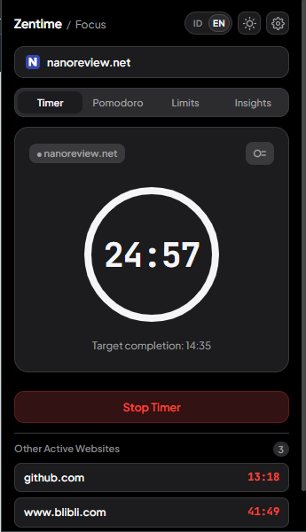
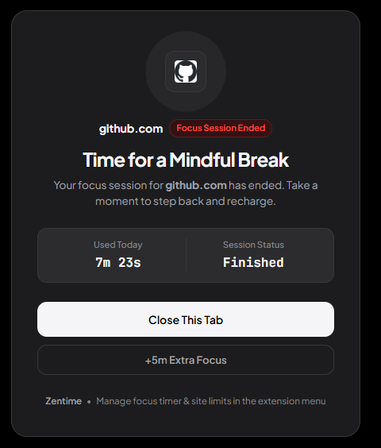
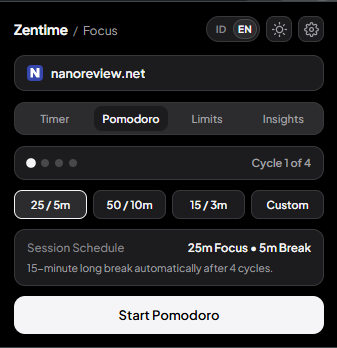
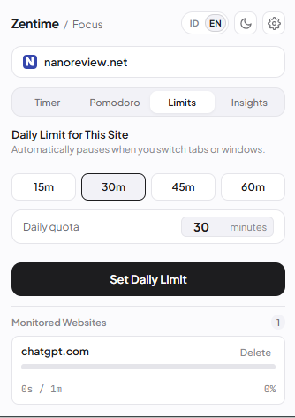
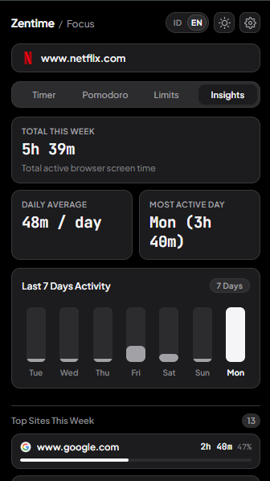

# Zentime ⏳

> A clean, distraction-free Chrome extension for site-specific focus timers and daily screen time limits.

[](https://developer.chrome.com/docs/extensions/mv3/intro/)
[](https://github.com/arkhabw/Zentime/releases/tag/v1.0.0)
[](LICENSE)
[](https://developer.mozilla.org/en-US/docs/Web/JavaScript)
[](#design-philosophy)

---

<div align="center">

| ⏱️ Active Focus Countdown (Ring Style) | 🧘 Mindful Interstitial Pause Screen |
| :---: | :---: |
|  |  |
| <sub><i>Per-website countdown with multi-site tracking</i></sub> | <sub><i>Calming full-page pause when session finishes</i></sub> |

</div>

---

## Overview

**Zentime** is a lightweight, privacy-focused Google Chrome extension designed to help you regain control over your digital habits. Whether you need a short Pomodoro session for writing or want to cap your daily YouTube or social media scrolling to 30 minutes, Zentime gives you the right tools without clutter.

Built strictly under **Manifest V3** with zero external dependencies, Zentime runs fast, uses minimal system resources, and stores all data locally on your device.

---

## Key Features

<div align="center">

| 🍅 Pomodoro Cycles | 🛑 Daily Quotas (Light Theme) | 📊 Screen Time Analytics |
| :---: | :---: | :---: |
|  |  |  |
| <sub><i>4-cycle workflow & automatic long breaks</i></sub> | <sub><i>Active-tab tracking & dual-theme support</i></sub> | <sub><i>7-day activity bar chart & top sites</i></sub> |

</div>
<br>

### ⏱️ Mode 1: Manual Focus Timer
- **Instant Website Countdown**: Target specific websites with a timer (e.g., 25 minutes on GitHub or Docs).
- **Quick Presets**: Single-click presets for `15m`, `25m`, `45m`, and `60m`.
- **Custom Stepper**: Adjust duration up or down in 5-minute increments or input any custom minute count.
- **Precision Countdown**: Large, high-contrast monospace countdown with a linear remaining-time progress bar.
- **Multi-Site Monitor**: Track multiple running timers across different websites simultaneously.

### 🍅 Mode 2: Pomodoro Cycle Tracker & Mindful Breaks
- **Structured Focus & Break Cycles**: Classic 25/5m, Deep Work 50/10m, or Sprint 15/3m sessions with automatic 15-minute long breaks after 4 cycles.
- **Apple HIG Cycle Indicator**: Clean 4-dot visual cycle progress tracker (`● ○ ○ ○`).
- **Automated Mindful Break Redirection**: When a focus session finishes, tabs automatically transition to a serene break screen with a live break countdown and calming breathing animations.
- **Mindful Wellness Prompts**: Rotating health and posture tips during breaks (e.g., 20-20-20 eye rest rule, hydration, deep breathing).
- **One-Click Phase Progression**: Skip breaks early or start the next cycle seamlessly.

### 📊 Mode 3: Daily Screen Time Limits & Mindful Blocker
- **Real-Time Active-Tab Tracking**: Second-by-second precision monitoring across all visited websites; automatically pauses the moment you switch tabs or minimize the browser.
- **Configurable Daily Quotas**: Set allowance per website (e.g., 30 minutes on `youtube.com`).
- **Mindful Site Blocker (`blocked.html`)**: Automatically redirects to an aesthetic Apple HIG-styled "Take a Breath" screen when quota is exceeded.
- **Emergency +5m Snooze**: Provides a mindful grace period button (+5m) or a single-click tab closer.
- **Dynamic Usage Bar**: Visual indicators that shift from safe to warning (at 70%) and alert states (at 100%).
- **Site Management Feed**: View and delete tracked websites with one click.

### 📈 Mode 4: 7-Day Screen Time Analytics & Day Drilldown
- **Pure CSS/SVG 7-Day Bar Chart**: Clean vertical bar chart showing daily screen time distribution over the past week.
- **Interactive Day Drilldown**: Click any day bar (e.g. Friday) to instantly filter top visited domains and metrics for that specific date.
- **7-Day Reset Button**: High-contrast `← 7 Hari` button to return to the weekly aggregate overview.
- **Automatic 7-Day Retention Purge**: Data older than 7 days is automatically purged on startup to preserve local storage.

### ⌨️ Power-User Shortcuts & Context Menus
- **Global Keyboard Shortcuts**:
  - `Alt + Shift + Z`: Open/close the Zentime popup from any webpage.
  - `Alt + Shift + S`: Start a 25m Pomodoro focus session on the active tab instantly.
  - `Alt + Shift + B`: Trigger an instant mindful pause screen.
- **Right-Click Context Menus**: Right-click anywhere on a webpage to start a Pomodoro session or configure a daily limit.
- **Customizable**: Quick-link button to customize shortcuts via `chrome://extensions/shortcuts`.

### ⚙️ Settings Modal & Audio Control
- **Dedicated Settings Panel**: Accessible via the gear icon in the header.
- **Sound Toggle Switch**: Enable or mute the gentle 10-second Tibetan singing bowl chime.
- **Privacy Transparency**: Clear offline data guarantee displayed in-app.

### 🔔 System Notifications, Audio Chimes & Live Badges
- **10-Second Gentle Audio Chime**: Calming harmonic chords synthesized via pure Web Audio API when timers finish or quotas are hit.
- **Desktop Alerts**: Receive system notifications via `chrome.notifications` the moment a timer finishes or a daily limit is reached.
- **Toolbar Icon Badge**: Real-time remaining minutes badge displayed directly on the extension icon in Chrome's toolbar.

### 🌗 Light & Dark Theme
- **Dual-Theme Support**: Seamlessly toggles between high-contrast Matte Light and Obsidian Dark modes.
- **System Preference Aware**: Automatically adapts to your operating system's color scheme (`prefers-color-scheme`).

### 🌐 Bilingual Support (English & Indonesian)
- **Instant Language Slider**: Switch on the fly between English (`EN`) and Indonesian (`ID`) via a smooth, tactile header slider switch.
- **Persistent Localization**: Automatically remembers your preferred language and localizes the entire interface, status indicators, and desktop notifications.

---

## Design Philosophy

Zentime is crafted with strict **Anti-Slop UI** discipline:
- **No Generic AI Gimmicks**: Free of decorative status dots, blurred glow halos, rainbow gradients, and excessive pill-shaped capsules.
- **Typography-First Hierarchy**: High-contrast, tabular monospace numbers for zero layout jitter.
- **Accessibility & Contrast**: Conforms to WCAG AA contrast standards (> 5:1) with visible `:focus-visible` keyboard navigation.
- **Minimal Footprint**: Clean vanilla JavaScript, semantic HTML5, and pure CSS. No bloated node modules or framework overhead.

---

## Installation (Developer Mode)

Since Zentime is an unpacked extension, you can install it in Google Chrome in less than a minute:

### Option A: Quick ZIP Download (Recommended)
1. Download **[zentime-v1.0.0.zip](https://github.com/arkhabw/Zentime/releases/download/v1.0.0/zentime-v1.0.0.zip)** from the [Latest Release](https://github.com/arkhabw/Zentime/releases/tag/v1.0.0).
2. Extract the ZIP file to a folder on your computer.

### Option B: Clone via Git
```bash
git clone https://github.com/arkhabw/Zentime.git
```

### Enable in Google Chrome:
1. Open Chrome and navigate to: `chrome://extensions/`
2. Toggle **Developer mode** in the top-right corner.
3. Click **Load unpacked** and select the folder (where `manifest.json` is located).
4. Click the Extensions (puzzle) icon in your toolbar and pin **Zentime** for 1-click access.

---

## How It Works

```
┌─────────────────┐      Tabs / Window Focus Events      ┌──────────────────────┐
│   Active Tab    │ ───────────────────────────────────> │  background.js (SW)  │
└─────────────────┘                                      └──────────┬───────────┘
                                                                    │
                        ┌───────────────────────────────────────────┼───────────────────────────────────────────┐
                        │                                           │                                           │
                        ▼                                           ▼                                           ▼
             ┌─────────────────────┐                     ┌─────────────────────┐                     ┌─────────────────────┐
             │    chrome.alarms    │                     │   chrome.storage    │                     │chrome.notifications │
             │  (Accurate Timing)  │                     │   (Local & Private) │                     │  (Desktop Alerts)   │
             └─────────────────────┘                     └─────────────────────┘                     └─────────────────────┘
```

1. **Service Worker (`background.js`)**: Tracks tab activations (`chrome.tabs.onActivated`), window focus changes (`chrome.windows.onFocusChanged`), and schedules alarms via `chrome.alarms`.
2. **Local Storage (`chrome.storage.local`)**: Stores active manual timers and daily usage counters organized by date key (`YYYY-MM-DD`).
3. **Interface (`popup.html` & `popup.js`)**: Instant feedback UI with zero external network requests.

---

## Project Structure

```text
web-timer-extension/
├── docs/assets/          # README preview screenshots
│   ├── preview-timer.png
│   ├── preview-blocker.png
│   ├── preview-pomodoro.png
│   ├── preview-limits-light.png
│   └── preview-insights.png
├── fonts/
│   ├── JetBrainsMono-Variable.woff2 # Tabular numbers font
│   └── PlusJakartaSans-Variable.woff2 # Clean interface font
├── icons/
│   ├── icon16.png        # Toolbar icon (16x16)
│   ├── icon48.png        # Extension management icon (48x48)
│   └── icon128.png       # Web Store & notification icon (128x128)
├── store-assets/         # Chrome Web Store promotional graphics
│   ├── preview.html      # Asset visualizer & 1-click PNG exporter
│   ├── promo-small-440x280.svg
│   ├── marquee-1400x560.svg
│   ├── screenshot-1-timer.svg
│   ├── screenshot-2-blocker.svg
│   ├── screenshot-3-insights.svg
│   └── screenshot-4-settings.svg
├── audio.html            # Offscreen document host for Web Audio
├── audio.js              # Synthesized 10s tranquil harmonic bell chime
├── background.js         # Service worker (real-time tracking, blocker, alarms, shortcuts)
├── blocked.html          # Mindful "Take a Breath" screen
├── blocked.css           # Apple HIG styling for mindful blocker
├── blocked.js            # Interstitial logic (Close Tab & +5m snooze)
├── manifest.json         # Extension configuration & MV3 permissions
├── package.js            # Automated packaging script (Node.js)
├── package-extension.ps1 # Packaging script (PowerShell)
├── popup.html            # Main 4-tab segmented popup interface
├── popup.css             # Anti-slop matte styling & dark mode tokens
├── popup.js              # UI controller, timer loops, chart rendering, & storage sync
├── STORE_LISTING.md      # Ready-to-use Chrome Web Store copy & justifications
├── PRIVACY_POLICY.md     # 100% offline privacy policy documentation
├── RELEASE_GUIDE.md      # Step-by-step Chrome Web Store submission guide
└── README.md             # Project documentation
```

---

## 📦 Building the Distribution Package

To build a clean `.zip` archive ready for upload to the Chrome Web Store:

```bash
# Using Node.js:
node package.js

# Or using PowerShell:
.\package-extension.ps1
```

The distribution bundle will be generated in `dist/zentime-v1.0.0.zip` (verified 100% free of `.git`, markdown, and test files).

---

## Permissions & Privacy

Zentime adheres to the principle of least privilege:

| Permission | Purpose |
|---|---|
| `tabs` | Identifies active domain name to measure screen time and display the mindful block page when limits are reached. |
| `alarms` | Runs reliable background alarms even when the popup is closed. |
| `notifications` | Notifies you when a focus session ends or a screen time limit is hit. |
| `storage` | Stores your timer preferences and daily usage locally on your machine. |
| `offscreen` | Synthesizes gentle Tibetan singing bowl audio chimes via Web Audio API. |
| `contextMenus` | Provides quick right-click actions ("Start 25m focus", "Set daily limit"). |

> **Privacy Guarantee**: Zentime does **not** collect, track, or transmit any browsing history or personal data. Everything remains strictly inside your local browser.

---

## License

This project is licensed under the [MIT License](LICENSE) - feel free to modify and use it for your own focus workflows.
